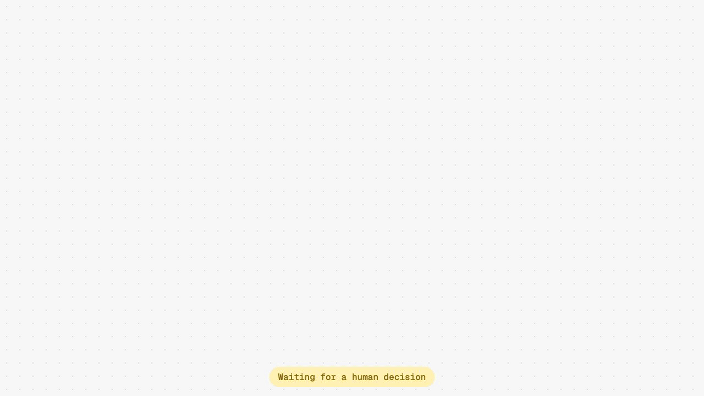
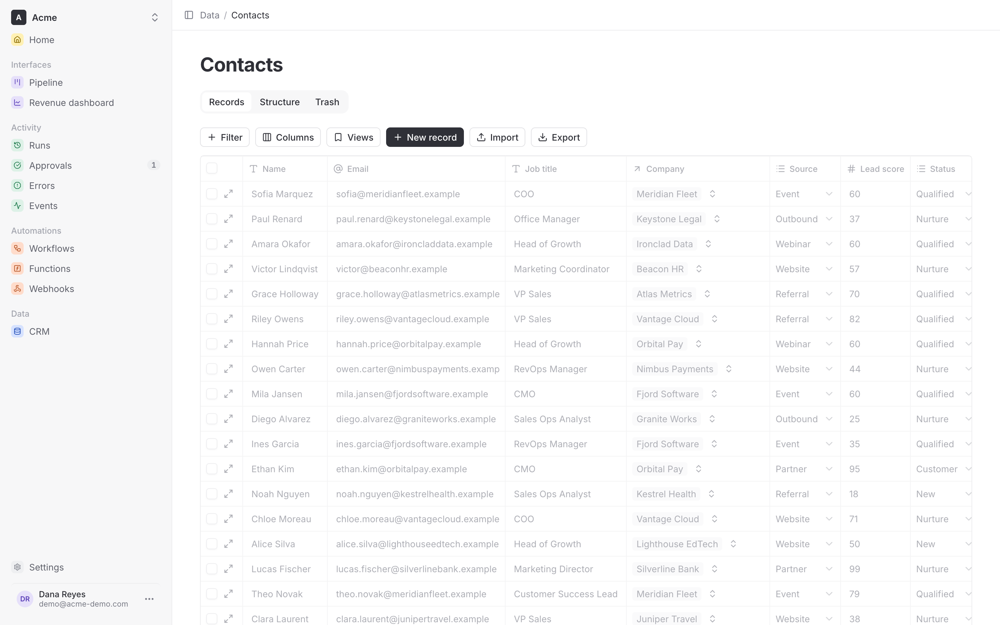
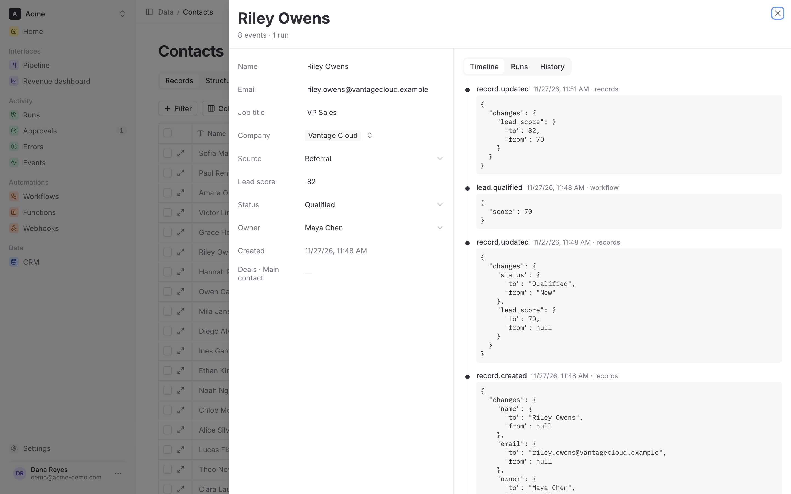
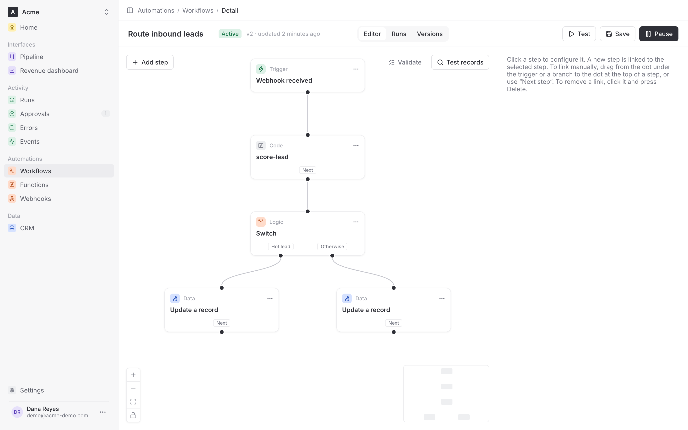
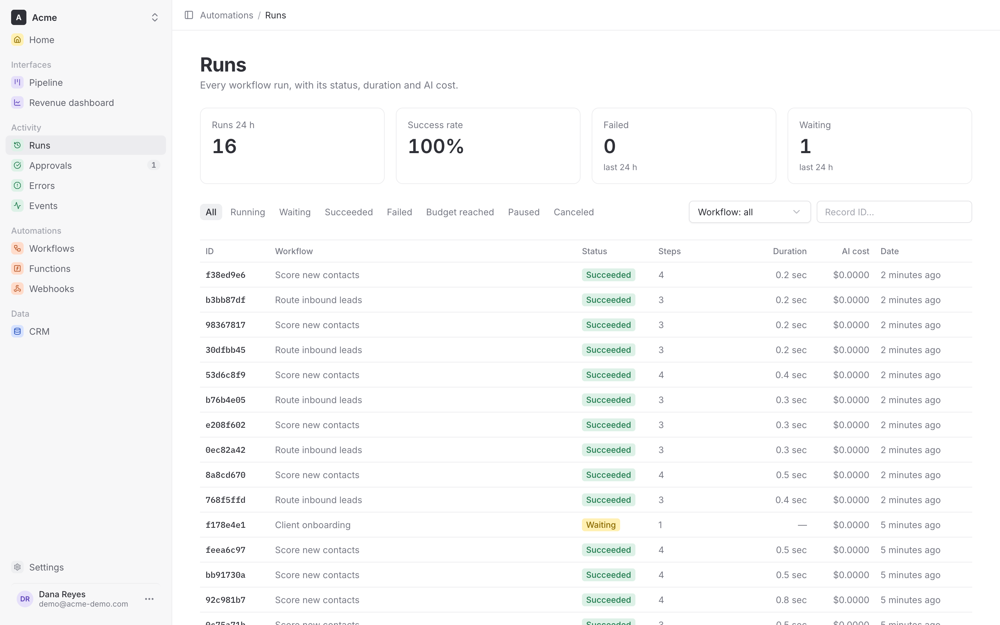
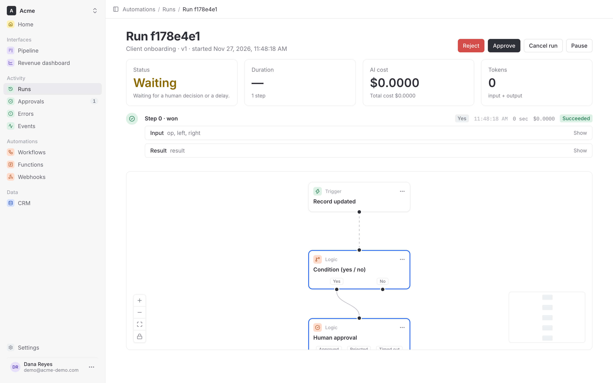
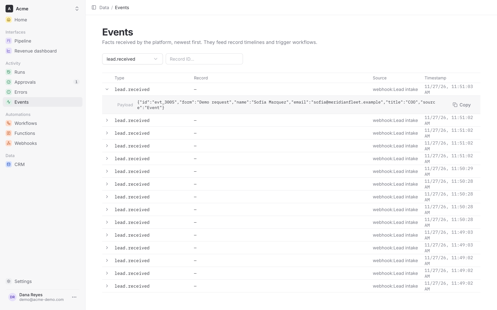

<h1>
  <picture>
    <source media="(prefers-color-scheme: dark)" srcset="docs/brand/logo-dark.svg">
    
  </picture>
</h1>

**Stop renting tools that almost fit.**

Describe the CRM, workflow or dashboard you need. Your AI agent builds it on
Runbase, and it keeps running: your data, your rules, no per-seat pricing.

```sh
git clone https://github.com/getrunbase/runbase && cd runbase && ./run.sh
```

[Quickstart](#quickstart) · [Use cases](#what-teams-build-with-it) · [Screenshots](#see-it-in-the-app) · [Docs](#documentation) · [Discussions](https://github.com/getrunbase/runbase/discussions)

<picture>
  <source media="(prefers-color-scheme: dark)" srcset="docs/readme-assets/motion/hero-dark.gif">
  
</picture>

[](LICENSE)
[](packages/node-sdk/LICENSE)
[](apps/docs/content/docs/en/reference/mcp/index.mdx)
[](docs/self-hosting.md)
[](https://github.com/getrunbase/runbase/actions/workflows/ci.yml)
[](https://github.com/getrunbase/runbase/releases)
[](https://github.com/getrunbase/runbase/discussions)
[](https://glama.ai/mcp/servers/getrunbase/runbase)
[](https://github.com/getrunbase/runbase/releases)
[](https://github.com/getrunbase/runbase/stargazers)

## How it works

1. **You describe the tool** to Claude Code, Codex, Cursor or any MCP client.
2. **The agent builds it** through one MCP server: data model, events and
   webhooks, functions, workflows and pages. Every change is validated,
   versioned and reversible before it goes live.
3. **Your team uses it** in the app, and it keeps running: workflows run on
   triggers, retry on failure and wait for approvals when you ask them to.

<picture>
  <source media="(prefers-color-scheme: dark)" srcset="docs/readme-assets/motion/how-it-works-dark.gif">
  
</picture>

Self-host it with Docker, with unlimited workspaces for free, or use the
managed cloud. Leave anytime: the core is open source and your data stays
yours.

## What teams build with it

Each example below starts from the prompt shown.

### A lightweight CRM with lead scoring

_For sales and growth teams._

> "Build a small CRM: companies and contacts, a lead score, a workflow that scores new contacts, and a pipeline page."

The agent creates the objects with typed fields and relations, writes a `score-lead` function, wires a workflow that scores every new contact, and publishes a kanban of deals by stage.

<picture>
  <source media="(prefers-color-scheme: dark)" srcset="docs/readme-assets/motion/usecase-crm-dark.gif">
  
</picture>

### Inbound lead routing

_For marketing ops and RevOps._

> "When a lead comes in from our form, score it, mark hot leads for sales and keep the others in nurture."

A signed webhook turns each form submission into a deduplicated event and a contact record. The workflow scores the lead, branches on the score and updates the record. Every run is logged and can be replayed.

<picture>
  <source media="(prefers-color-scheme: dark)" srcset="docs/readme-assets/motion/usecase-webhook-dark.gif">
  
</picture>

### A pipeline and revenue dashboard

_For founders, sales leads and RevOps._

> "Give me a dashboard of our deals: total deals, open pipeline, won revenue, average deal size, and deals by stage and by owner."

The agent writes a page with KPI cards and charts on top of your live data, then checks it with a screenshot before publishing it.

<picture>
  <source media="(prefers-color-scheme: dark)" srcset="docs/readme-assets/motion/usecase-dashboard-dark.gif">
  
</picture>

### Client onboarding with human approval

_For ops and customer success._

> "When a deal is won, prepare the client onboarding, but wait for a manager to approve before anything goes out."

The workflow pauses on a human approval step. The run waits in the Approvals inbox until someone approves or rejects it, then carries on.

<picture>
  <source media="(prefers-color-scheme: dark)" srcset="docs/readme-assets/motion/usecase-approval-dark.gif">
  
</picture>

## See it in the app

<table>
<tr>
<td width="33%" valign="top">
<picture>
  <source media="(prefers-color-scheme: dark)" srcset="docs/readme-assets/screens/data-table-dark.png">
  
</picture>
<br><sub><b>Data</b>: typed fields, relations and a lead score</sub>
</td>
<td width="33%" valign="top">
<picture>
  <source media="(prefers-color-scheme: dark)" srcset="docs/readme-assets/screens/record-detail-dark.png">
  
</picture>
<br><sub><b>Records</b>: fields, timeline, runs and history</sub>
</td>
<td width="33%" valign="top">
<picture>
  <source media="(prefers-color-scheme: dark)" srcset="docs/readme-assets/screens/workflow-editor-dark.png">
  
</picture>
<br><sub><b>Workflows</b>: visual editor, versioned and validated</sub>
</td>
</tr>
<tr>
<td width="33%" valign="top">
<picture>
  <source media="(prefers-color-scheme: dark)" srcset="docs/readme-assets/screens/runs-history-dark.png">
  
</picture>
<br><sub><b>Runs</b>: every execution logged, retry or replay</sub>
</td>
<td width="33%" valign="top">
<picture>
  <source media="(prefers-color-scheme: dark)" srcset="docs/readme-assets/screens/approval-run-dark.png">
  
</picture>
<br><sub><b>Approvals</b>: a person signs off before the run continues</sub>
</td>
<td width="33%" valign="top">
<picture>
  <source media="(prefers-color-scheme: dark)" srcset="docs/readme-assets/screens/webhook-events-dark.png">
  
</picture>
<br><sub><b>Events</b>: signed webhooks, deduplicated events</sub>
</td>
</tr>
</table>

## Building blocks

- **Data**: databases, objects with typed fields and relations, records with
  history, trash, merge and safe bulk edits. Read-only SQL included.
- **Events and webhooks**: signed inbound webhooks, deduplicated events,
  timelines and funnels.
- **Functions**: versioned JavaScript in a sandbox, with declared network,
  secrets and data permissions, and dry runs.
- **Workflows**: triggers, built-in and connector nodes, AI steps, waits, human approvals, retries
  and replays.
- **Interfaces**: pages, dashboards and TSX code components in an isolated
  runtime.
- **Workspaces**: as many as you want, free. One per client or per project,
  fully isolated, each with its own keys and quotas.

## Quickstart

Requirements: Docker with the Compose plugin and `openssl`.

```sh
git clone https://github.com/getrunbase/runbase runbase && cd runbase
./run.sh you@example.com
```

`run.sh` writes `.env` on first run (through `./setup.sh`), starts the stack,
creates your admin account and prints the sign-in URL and the MCP commands.
Without email set up, the sign-in link appears in
`docker compose -f docker-compose.selfhost.yml logs web`.

<details>
<summary>Manual steps</summary>

```sh
./setup.sh
docker compose -f docker-compose.selfhost.yml up -d --wait
docker compose -f docker-compose.selfhost.yml exec worker pnpm admin:create you@example.com
```

Then open `http://localhost:3000/login`.

</details>

### Connect your AI agent

Use the URL `http://localhost:3000/api/mcp` (sign-in through the browser):

```sh
claude mcp add --transport http runbase http://localhost:3000/api/mcp   # Claude Code, then /mcp
codex mcp add runbase --url http://localhost:3000/api/mcp               # Codex, then codex mcp login runbase
gemini mcp add --transport http runbase http://localhost:3000/api/mcp   # Gemini CLI, then /mcp auth runbase
```

Cursor: add `{"mcpServers":{"runbase":{"url":"http://localhost:3000/api/mcp"}}}` to `~/.cursor/mcp.json`.
Claude Desktop / claude.ai: Settings → Connectors → Add custom connector.
ChatGPT (web): chatgpt.com/plugins → Add custom MCP server. Any other MCP client:
the URL with OAuth, or an API key as `Authorization: Bearer <key>`.

HTTPS, backups and upgrades: [self-hosting guide](docs/self-hosting.md).

## How it compares

Facts as of November 2026, from each vendor's public documentation. Corrections
are welcome.

|                         | Runbase            | n8n                     | Zapier       | Make        | Activepieces            | Airtable    | Retool           |
| ----------------------- | ------------------ | ----------------------- | ------------ | ----------- | ----------------------- | ----------- | ---------------- |
| Self-host               | Yes, Docker        | Yes                     | No           | No          | Yes                     | No          | Yes (paid plans) |
| Source license          | AGPL-3.0           | Sustainable Use License | Proprietary  | Proprietary | MIT (community edition) | Proprietary | Proprietary      |
| Built through MCP       | Yes, every feature | Partial                 | Partial      | Partial     | Partial                 | Partial     | No               |
| Database with relations | Yes                | Basic tables            | Basic tables | Data stores | Basic tables            | Yes         | Yes              |
| Workflows               | Yes                | Yes                     | Yes          | Yes         | Yes                     | Basic       | Yes              |
| User-facing pages       | Yes                | Forms                   | Yes          | No          | Forms                   | Yes         | Yes              |
| Sandboxed custom code   | Yes                | Yes                     | Yes          | Paid plans  | Yes                     | Scripts     | Yes              |

"Built through MCP" means an agent can create and change the data model,
workflows and interfaces themselves, not only trigger existing actions.

## Documentation

The docs site lives in [`apps/docs`](apps/docs) (`pnpm --filter @getrunbase/docs dev`):

- [Quickstart](apps/docs/content/docs/en/quickstart.mdx)
- [Concepts](apps/docs/content/docs/en/concepts/index.mdx)
- [Writing a connector](apps/docs/content/docs/en/guides/connectors.mdx)
- [Template format](apps/docs/content/docs/en/guides/templates.mdx)
- References generated from the code: [REST API](apps/docs/content/docs/en/reference/api.mdx),
  [MCP tools](apps/docs/content/docs/en/reference/mcp/index.mdx),
  [workflow nodes](apps/docs/content/docs/en/reference/nodes.mdx)

## Community

Questions, ideas and show-and-tell go to
[GitHub Discussions](https://github.com/getrunbase/runbase/discussions). Bugs
go to [issues](https://github.com/getrunbase/runbase/issues).

## Licensing

Runbase is open source.

| Path                                                                                              | License                                   |
| ------------------------------------------------------------------------------------------------- | ----------------------------------------- |
| Repository root, `apps/*`, `packages/core`                                                        | [AGPL-3.0-only](LICENSE)                  |
| `packages/sdk`, `packages/node-sdk`, `packages/kit`, `packages/ui`, `connectors/*`, `templates/*` | MIT (each folder ships its own `LICENSE`) |

The core is licensed under the GNU Affero General Public License v3.0. You can use, modify and self-host it freely. If you modify it and let third parties use it over a network (for example as a hosted service), you must publish your modifications under the same license. Code you write on top of the MIT SDK, kit, connectors and templates is not affected.

Versions up to and including v0.3.0 were released under FSL-1.1-ALv2 and remain under that license. Copyright and licensing notices are in [NOTICE](NOTICE).

Every `package.json` declares a matching `license` field. `pnpm check:licenses` verifies the whole layout and `pnpm test:licenses` runs its tests.

### Trademarks

The Runbase name and logo are trademarks of MENTIONABLE SAS. The code license does not cover them; see [TRADEMARKS.md](TRADEMARKS.md).

## Telemetry

Anonymous telemetry is on by default: the worker sends one ping per day
(random instance id, version, platform, bucketed counts of workspaces,
workflows and runs; no user, tenant or host data). Set `RUNBASE_TELEMETRY=0`
to turn it off. Every
field is listed in the [self-hosting guide](docs/self-hosting.md#anonymous-telemetry),
and the worker logs on start whether telemetry is on.

Operational metrics (OpenTelemetry) are off unless you set
`OTEL_METRICS_EXPORTER`, and are exported only to the endpoint you choose: see
[observability](docs/observability.md).

## Contributing

Read [CONTRIBUTING.md](CONTRIBUTING.md), the [code of conduct](CODE_OF_CONDUCT.md)
and the [security policy](SECURITY.md). Contributions are accepted under the
[CLA](CLA.md).
